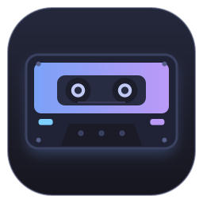

<p align="center"></p>
<h1 align="center">mixtape</h1>
<p align="center">A fast, themeable playlist builder for local music libraries.<br>C++20 · Dear ImGui · Windows + Linux</p>

- Add any number of music folders. They are scanned in the background and tagged with TagLib (title / artist / album / track / length). Results are cached, so the next launch is instant.
- Search across title, artist, album, filename and folder (all words must match). Table view with sortable columns, or a folder tree with "add whole folder" buttons.
- Tick tracks (or click rows, shift-click for ranges), then **Add to playlist** or press Enter. Double-click adds a single track. Right-click for "add whole album / everything by artist / whole folder".
- Playlist pane: drag rows to reorder, Del removes, Ctrl+Up/Down nudges, shuffle, sort, dedupe, drop-missing. Missing files are highlighted red, duplicates yellow.
- Saves `.m3u8` (`#EXTM3U` / `#EXTINF`) with relative or absolute paths and optional backslash separators, so it works on portable players such as HiBy / Rockbox / FiiO as well as foobar2000, VLC, mpv, Strawberry etc.
- Eight themes (Tokyo Night, Catppuccin Mocha, Gruvbox, Nord, Rosé Pine, Dracula, Everforest, Kanagawa), JetBrains Mono embedded, DPI aware, adjustable UI scale.
- Drop folders, playlists or audio files onto the window.
- Full Unicode: Latin, Greek and Cyrillic come from the embedded JetBrains Mono; Japanese, Chinese, Korean and symbols are merged in from system fonts (Yu Gothic / Meiryo / Microsoft YaHei / Malgun / Segoe UI Symbol on Windows, Noto Sans CJK / Droid Sans Fallback / DejaVu on Linux). The glyph set is built from the characters that actually occur in your library, so rare kanji and kaomoji titles render too; the atlas is rebuilt automatically after a scan finds new characters. Search is case-insensitive for Cyrillic and Greek as well.

## Build

Dependencies are fetched automatically by CMake (GLFW, Dear ImGui, TagLib, nlohmann/json, JetBrains Mono). You need CMake ≥ 3.24, git, and a C++20 compiler.

### Windows (Visual Studio 2022 / 2026)

```powershell
cmake -S . -B build -A x64
cmake --build build --config Release
.\build\Release\mixtape.exe
```

The executable is fully static (static CRT) and needs no DLLs next to it.

### Linux

```bash
# Debian / Ubuntu build deps
sudo apt install build-essential cmake git pkg-config libgl1-mesa-dev \
  libx11-dev libxrandr-dev libxinerama-dev libxcursor-dev libxi-dev \
  libwayland-dev libxkbcommon-dev wayland-protocols
# Arch: sudo pacman -S base-devel cmake git mesa libx11 libxrandr libxinerama libxcursor libxi wayland libxkbcommon wayland-protocols

cmake -S . -B build -DCMAKE_BUILD_TYPE=Release
cmake --build build -j
./build/mixtape
```

If you do not want Wayland support, add `-DGLFW_BUILD_WAYLAND=OFF`. Native folder/file dialogs use `zenity` or `kdialog` if present; otherwise a built-in picker is used.

## Where things live

| | Windows | Linux |
|---|---|---|
| config + library cache | `%APPDATA%\mixtape\` | `$XDG_CONFIG_HOME/mixtape/` (`~/.config/mixtape/`) |
| default playlist folder | `%USERPROFILE%\Music\Playlists` | `~/Music/Playlists` |

Change the playlist folder in **Settings** (Ctrl+,). Point it at your player's playlist directory (e.g. `E:\Playlists` on a HiBy card) and enable *Backslash separators* so the paths come out as `..\Library\Artist - Title.mp3`.

## Shortcuts

| Key | Action |
|---|---|
| Ctrl+F | focus search |
| Enter | add selected tracks to the playlist |
| Ctrl+A / Esc | select all / clear selection (library or playlist, whichever is focused) |
| Del / Backspace | remove selected playlist rows |
| Ctrl+Up / Ctrl+Down | move selected playlist rows |
| Ctrl+S / Ctrl+Shift+S | save / save as |
| Ctrl+N / Ctrl+O | new / open playlist |
| Ctrl+, | settings |

## Layout

```
src/main.cpp        window, GL context, font + theme setup, main loop
src/app.*           all UI (header, sidebar, library table/tree, playlist pane, modals, toasts)
src/library.*       background scanner + TagLib metadata + JSON cache
src/playlist.*      .m3u8 read / write
src/theme.*         colour palettes and ImGui style
src/platform.*      native dialogs (IFileDialog / zenity / kdialog), config dirs, dark title bar
src/filebrowser.*   in-app fallback picker
cmake/embed.cmake   turns the font / icon files into C arrays
assets/             icon (svg master, png set, .ico, raw rgba for the window icon), .desktop, .rc; make_icon.py regenerates them
.github/workflows   CI: builds and tests on Windows and Linux, uploads the binaries as artifacts
```
